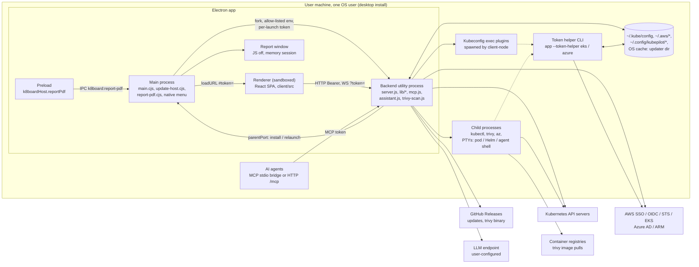

# K8Board — Architecture and Production-Readiness Audit

| | |
|---|---|
| **Date** | 2026-11-07 |
| **Scope** | Repository at commit `396c29e` ("mac fixes"), version `1.8.1` (`VERSION`, `package.json`). Electron shell, Node/Express backend, React client, MCP server, cloud sign-in helpers, in-app updater, Trivy scanning, Docker image, GitHub Actions. |
| **Line numbers** | `server.js` references are to the committed file at `396c29e` (5,000 lines). The working copy had uncommitted changes during the review (see "Work in progress" below), so line numbers in the working copy may differ. Other files were unchanged unless noted. |
| **Method** | Static reading of the source, configuration, tests and workflows; targeted inspection of `@kubernetes/client-node` 2.0.2 in `node_modules`; read-only look at an existing local packaging output. No builds, no test runs, no dynamic testing. Coverage figures are the latest CI numbers supplied with the brief. |
| **Previous audit** | `docs/audit/2026-10-21-production-audit.md` (KubePilot 1.6.0 working tree). Status of its findings is in section 5. |

### Work in progress at the time of review

Two changes were being made while this review ran. They are treated as in flux: the current design is described, but no findings are filed against half-written code.

- **Home / cluster-selection page (no connection at startup).** `client/src/App.jsx`, `components/Home.jsx` (new), `components/shell/{useAuthGate,useContexts,LoadingScreen,ViewOutlet,routes}.js(x)`, `hooks/useHashRoute.js`, `AuthErrorModal.jsx`, `ClusterSwitcher.jsx`, `Preferences.jsx`, `lib/kinds.js`, and about 94 lines in `server.js` (`connectedContext`, recent clusters, `POST /api/config/disconnect`, `PUT /api/settings/startup`, local sign-in hints, the AWS session keeper running only while connected).
- **Microsoft Store identity from repository variables.** `.github/workflows/release.yml`, `package.json` (`dist:store`, `appx.publisherDisplayName`), `scripts/store-identity.mjs` and its test, `docs/store/*`.

Considerations for the Home work are listed at the end of section 4 as notes, not findings.

### Remediation status (added 2026-11-07, after the review)

The report below is unchanged; this table tracks what has been done since. Details are in `CHANGELOG.md` under [Unreleased].

| Finding | Status | What changed |
|---|---|---|
| SEC-02 | **Fixed** | The backend takes K8Board's secrets out of its own environment at startup (`holdAppSecrets`, `lib/child-env.mjs`). The exec gate also passes a filtered environment to every credential plugin. Tested with a stub plugin (`test/exec-plugin-env.test.mjs`). |
| SEC-03 | **Fixed** | MCP responses from logs, events, Helm, custom resources, Argo CD, objects and YAML are scrubbed (`lib/agent-scrub.mjs`), governed by the *Secret values* switch (`test/mcp-scrub.test.mjs`). |
| REL-01 | **Fixed** | Credential helpers time out after 3 minutes and are killed. Disconnect and Cancel stop them. The client bounds requests at 5 minutes. |
| REL-02 | **Fixed** | Typed Kubernetes clients default to a 30 s timeout (`withDefaultTimeout`, `lib/k8s-ops.mjs`). AWS SDK clients get `requestHandler` limits, and Azure fetches get an `AbortSignal` (`lib/net-timeouts.mjs`). |
| REL-04 | **Fixed** | `settings.json` is written atomically. |
| BLD-01 | **Mostly fixed** | Done: green CI and a `main` commit are required, CodeQL and Trivy block, gitleaks is added, images are cosign-signed, and a GitHub App token is used when configured. Open: build provenance stays best-effort on a private repository (a platform limit). The PAT is removed once the App is set up. |
| OBS-01 | **Mostly fixed** | Done: a rotating, scrubbed log file, Help → Export Diagnostics (masked) and request IDs. Open: replacing the silent `catch {}` blocks. |
| SEC-01 | **Open, needs accounts** | OS code signing needs a Windows signing service (for example Azure Trusted Signing) and an Apple Developer ID. asar needs a CJS backend bundle. |
| ARC-01 | **Open, planned** | Splitting `server.js` into domain routers is a multi-release refactor. It needs a plan before it starts. |

---

## 1. Executive summary

### Verdict

**K8Board is in good shape for production use as a single-user desktop tool.** Since the previous audit (graded C−), the five Critical findings have been closed or substantially reduced. Updates are now authenticated with a pinned Ed25519 key. The AI-agent terminal is gated and pinned to one cluster. AI agents get their own token, enforced by the server. Secrets are masked for agents. K8Board's own secrets are stripped from the processes it spawns itself. The engineering underneath is careful: argv-only spawning, strict validation, DNS-rebinding and origin defences, a hardened Electron shell with a single, sender-checked IPC call, and about 720 automated tests.

**It is not yet at the bar for broad or enterprise distribution, or for shared server deployments.** The installers are not OS-code-signed (Windows NSIS, macOS), and the unpacked app has no on-disk integrity check. Several reliability gaps can freeze a cluster view: credential helpers have no timeout, and most Kubernetes calls have none either. Server mode is still single-tenant with no audit trail. Overall grade for the desktop product: **B−**. Server mode is acceptable only as a single-user deployment behind an authenticating TLS proxy.

Findings: **0 Critical, 1 High, 12 Medium, 16 Low, 7 Info** (section 4).

### Top 5 risks

1. **Distribution trust (SEC-01, High).** Windows installers are unsigned and macOS builds are ad-hoc signed without notarization. `asar` and the asar-integrity fuses are off. The in-app updater is now signed, but first installs and on-disk app files have no OS-verifiable authenticity. Unsigned installers also condition users to click through SmartScreen and Gatekeeper warnings.
2. **Hangs on credential helpers and API calls (REL-01, REL-02).** `@kubernetes/client-node` runs exec credential plugins with no timeout, and request timeouts are armed only *after* authentication. The exec gate then shares one hung run with every request for that user. About 56 of 86 typed Kubernetes calls, and all AWS SDK and Azure token calls, have no timeout. Either can leave a cluster view stuck until the kubeconfig is reloaded or the app restarts.
3. **Gaps in secret egress control (SEC-02, SEC-03).** The per-launch UI API token stays in the backend's environment and is inherited by every kubeconfig exec plugin. This contradicts the stated control in `SECURITY.md`. Over MCP, pod logs, Helm values, custom resources and events reach agents without the text scrubbing the built-in assistant already applies.
4. **Release pipeline weaker than CI (BLD-01).** Releases run only `npm test`, can be cut from any tagged commit, and publish with a long-lived PAT. Trivy and CodeQL are non-blocking, provenance is best-effort, and the GHCR images are not cosign-signed.
5. **Growing monolith with little field diagnosability (ARC-01, OBS-01).** `server.js` grew from 4,303 to 5,000 lines and 91 routes, with no service layer between routes and the Kubernetes client. The desktop app keeps no log file, has no diagnostics export, and has no request IDs. When a user reports a bug there is nothing to collect.

### Top 5 strengths

1. **An authenticated update channel.** Ed25519 signature over `"KubePilot release <version>\n" + SHA256SUMS.txt`, with pinned keys (`lib/updater/keys.mjs:16-18`), version binding against downgrade (`lib/updater/verify.mjs:60-95`), and release gating on the key (`release.yml` "Require a trusted release-signing key"). The main process re-hashes the installer before running it (`electron/update-host.cjs:114-137`).
2. **Electron hardening with a minimal bridge.** Sandbox, `contextIsolation`, no `nodeIntegration`, DevTools off when packaged (`electron/main.cjs:577-587`). Navigation is locked to the backend origin and all permission requests are denied (`:615-630`, `:848-849`). One preload method, with a sender/frame/origin check (`electron/preload.cjs:10-13`, `electron/main.cjs:643-647`). Fuses disable RunAsNode, NODE_OPTIONS and inspect (`electron/after-pack.cjs:142-154`). The backend gets an allow-listed environment (`electron/main.cjs:308-355`).
3. **Local API defence in depth with a real agent boundary.** Constant-time bearer token, Host allowlist (421), Origin guard, case guard, CSP and security headers, and a loopback bind (`lib/auth.mjs`; `server.js:154-201`). The MCP token is a separate principal (`lib/auth.mjs:57-106`, `lib/paths.mjs:156-158`), backed by a UI-only route list (`server.js:287-293`), a write gate (`:264-269`) and Secret masking (`:276-281`), all covered by tests (`test/mcp-token.test.mjs`, `test/mcp-gate.test.mjs`).
4. **Injection and child-process discipline.** argv arrays only; `positional()` puts user values after `--`; a Windows `.cmd` metacharacter guard (`lib/kubectl.mjs:154-168, 206-211`); validators that reject a leading `-` (`lib/validate.mjs`). K8Board's secrets are stripped from every `spawnBin`/trivy/PTY child (`lib/child-env.mjs`). Helm and agent shells get a single-context temporary kubeconfig (`lib/helm-shell.mjs:30-44`; `server.js:4796, 4835`).
5. **Engineering hygiene.** 401 backend and about 320 client tests, including integration tests that boot the real server. 79% line coverage, with `server.js` and `mcp.js` now measured. SHA-pinned actions, `persist-credentials: false`, `npm ci --ignore-scripts`, Dependabot for npm/actions/docker, a digest-pinned base image and checksum-verified CLI downloads. A disciplined CHANGELOG, and a well-designed client data hook (`client/src/hooks/useRequest.js`: abort, dedupe, visibility pause, backoff).

---

## 2. Architecture overview

### Processes and components

| Process | Code | Role |
|---|---|---|
| Electron main | `electron/main.cjs`, `update-host.cjs`, `report-pdf.cjs`, `secret-key.cjs` | Picks a port and generates a per-launch token; unwraps the Windows data key (DPAPI via `safeStorage`); forks the backend as a `utilityProcess` with an allow-listed env; supervises it (3 restarts per 60 s, `:474-502`); waits for `/healthz`; loads the UI with `#token=`. Builds the native Clusters menu by calling the backend over HTTP; installs updates on the backend's request; renders report PDFs. |
| Token-helper CLI mode | `electron/main.cjs:29-170`, `eks-token.js`, `azure-token.js` | Kubeconfig `exec` entries run `<app> --token-helper eks` or `--token-helper azure`. This branch runs before the single-instance lock and the GUI, prints one ExecCredential, and exits. The EKS helper has its own Chromium profile. The Azure helper uses a mirrored profile so it can unwrap the DPAPI key, checked once per version by `--token-helper selftest`. |
| Backend (utility process) | `server.js` + `lib/*.mjs`, `assistant.js`, `mcp.js`, `aws-eks.js`, `azure-aks.js`, `trivy-scan.js`, `demo.js` | Express 5 REST API (91 routes in `server.js`, 4 in `assistant.js`, 7 in `lib/updater/routes.mjs`), one multiplexed WebSocket (`/ws/exec`: pod, Helm and agent terminals), and the MCP Streamable HTTP host (`/mcp`). Holds process-global `kubeConfig` / `currentContext` (`server.js:86-87`). Spawns kubectl, trivy, az and PTYs; `@kubernetes/client-node` spawns exec credential plugins. In packaged builds it is a single 9 MB bundle (`scripts/bundle-backend.mjs`, `electron/after-pack.cjs:72-99`). |
| Renderer | `client/src` (React 19, Vite 8) | Sandboxed SPA with hash routing (`hooks/useHashRoute.js`) and per-view data fetching through `useRequest`. Talks only HTTP/WS to the backend (`lib/api.js`); the token is kept in `sessionStorage`. |
| Report window | `electron/report-pdf.cjs` | Hidden window with JavaScript off, an in-memory session and a private scheme; prints self-contained HTML to PDF. |
| MCP stdio bridge | `mcp-stdio.js` → `mcp.js` | Run by AI clients; calls the running backend's REST API with the MCP token. |
| Docker / source | `Dockerfile`, `server.js` | Same backend, no Electron. `HOST=0.0.0.0` in the image; local shells off unless `K8BOARD_LOCAL_SHELL=1`. |

### Diagram

### Trust boundaries

| # | Boundary | Control today | Weak point |
|---|---|---|---|
| TB1 | Renderer → backend | Bearer token, Host/Origin guards, CSP `script-src 'self'`, sandboxed renderer | WS token in query string (SEC-05) |
| TB2 | Main ↔ backend | Allow-listed env (`main.cjs:308-355`); message port carrying only `kpUpdate` messages; main re-hashes installers | The main process trusts the backend's signature check (SEC-12, Info) |
| TB3 | AI agent → backend | Separate MCP token principal, UI-only routes, write gate, Secret masking | Text payloads unscrubbed (SEC-03); legacy header path for UI-token callers (by design) |
| TB4 | Cluster/cloud data → backend and agents | Validation of identifiers; image refs passed after `--` (`trivy-scan.js` `assertImageRef`) | Cluster-controlled text reaches agent prompts (inherent); registries chosen by pod specs |
| TB5 | Release channel → installed app | Signed checksum list for updates; Store MSIX signed by Microsoft | Installers not OS-signed; no on-disk integrity (SEC-01) |
| TB6 | Same-user processes / filesystem | 0600 files, DPAPI-sealed secrets on Windows | Plaintext secrets on macOS/Linux (SEC-04); token in exec plugin env (SEC-02) |
| TB7 | Network → server mode | Token, Host allowlist, rate limit | One shared, non-expiring identity; process-global context; no audit (SEC-05, SEC-06) |

### Module boundaries

The `lib/` extraction keeps going in the right direction. Pure, tested modules now cover auth, validation, cache, kubectl, exec gate, secret store, the helm shell, k8s ops, cluster health and network, event scope, security insights, the AWS SSO flow (947 lines) and the updater (`lib/updater/*`, about 1,580 lines). Most score 90–100% coverage.

`server.js` remains the hub, and it has grown. At `396c29e` it holds, in order:

| Lines | Responsibility |
|---|---|
| 1–366 | Imports, global state, middleware stack, path-rule validation, MCP gates, demo interception, static files |
| 367–888 | Kubeconfig loading/reload/remove, settings, MCP settings and token, config routes |
| 889–1502 | Azure AKS (browser PKCE and `az`), AWS EKS/SSO sign-in, session keeper, imports |
| 1503–1734 | AI agent detection and external launch; cluster auth check |
| 1735–2512 | Reads (namespaces, resources, storage, RBAC, resource, logs), exec, port-forward, YAML/apply/delete/scale/restart |
| 2512–3023 | Events, nodes, Helm (release storage via API), CRDs |
| 3024–3563 | Argo CD and the Security Center (operator reports and built-in Trivy) |
| 3564–4541 | Argo routes, cluster summary, metrics, topology |
| 4542–4648 | MCP host, SPA fallback, assistant and updater registration, error handlers |
| 4649–5000 | WebSocket terminals, graceful shutdown, listen |

Route handlers call `@kubernetes/client-node` directly (89 `makeApiClient` call sites, up from 75). Timeouts, pagination, redaction and caching are applied call by call, and that is why they are inconsistent (REL-02, REL-03, SEC-03). Two 17-case kind switches still exist (`server.js:1947-2016` uses `'Pod'`, `:2251-2322` uses `'pod'`).

---

## 3. Scorecard

| Area | Rating (1–5) | Justification |
|---|:---:|---|
| Architecture and module boundaries | 3 | Sound local-first process model and a growing set of clean `lib/` modules, but a 5,000-line `server.js` with no service layer between routes and the Kubernetes client. |
| Process model and IPC | 4 | Clear split of main / utility / renderer; one sender-checked IPC call; token-helper mode isolated before GUI startup; supervised backend. Complexity in the Windows helper-profile design is the main cost. |
| Security — desktop | 3 | Strong controls in the small (Electron, auth, validation, MCP principal, signed updates); unsigned installers, token in exec plugin env and unscrubbed MCP text are the gaps. |
| Security — server/Docker mode | 2 | Single shared non-expiring token, process-global context, no audit, plain HTTP; safe only single-user behind an authenticating proxy. |
| Secret storage and data handling | 3 | AES-256-GCM with purpose-bound AAD and a DPAPI-wrapped key on Windows; atomic 0600 writes for credentials; plaintext app secrets on macOS/Linux; unpruned backups. |
| Reliability | 3 | Supervisor, graceful shutdown, exec gate, partial-result fan-out and atomic kubeconfig writes; missing timeouts on helpers and most API calls; non-atomic settings writes. |
| Performance and scale | 3 | Virtualized tables and logs, bounded LRU cache, visibility-paused polling with backoff, paginated cluster summary; unpaginated lists, 5,000-pod truncation, whole-cache flushes, all UI chunks preloaded. |
| Frontend architecture | 4 | Consistent `useRequest` data layer, hash router, layered error boundaries, 574 ARIA attributes, live regions, skip link, CSP-safe theming; no route-level lazy loading; shell under active change. |
| Observability | 2 | Structured JSON logger, but no desktop log file, diagnostics export, request IDs, metrics or audit trail; about 30 log calls in `server.js`. |
| Testing | 3 | About 720 tests with real-server integration suites and 79% coverage; no e2e/Electron or packaged-app tests, MCP tool layer at 11%, no coverage thresholds. |
| Build, release and supply chain | 3 | Signed update checksums, SBOM, SHA-pinned actions, Dependabot, `--ignore-scripts`, digest-pinned base; unsigned installers, non-blocking scanners, PAT publishing, no working provenance. |
| Documentation and DX | 4 | Thorough README, USER-GUIDE, CONTRIBUTING, SECURITY and CHANGELOG; one-command dev setup; some drift between docs and CI; no architecture or threat-model document. |

---

## 4. Findings

Severity reflects the desktop product unless stated. Effort: S ≤ 2 days, M ≤ 2 weeks, L > 2 weeks.

| ID | Area | Sev. | Title | Evidence | Impact | Recommendation | Effort |
|---|---|---|---|---|---|---|---|
| SEC-01 | Supply chain | **High** | Installers not OS-signed; no on-disk integrity | `package.json:107-108` (`mac.identity: null`, `hardenedRuntime: false`); no signing configuration under `build.win` (`:139`); `package.json:78` `"asar": false`; `electron/after-pack.cjs:152-153` asar-only and integrity fuses `false`; ad-hoc signing `:161-190` | First installs are not authenticated by the OS; SmartScreen/Gatekeeper warnings condition users to click through; files of a per-user install can be modified without detection | Sign Windows builds (Azure Trusted Signing or an OV/EV certificate in a cloud HSM); Developer ID, hardened runtime and notarization on macOS. Then evaluate a CJS backend bundle inside `asar` with `EnableEmbeddedAsarIntegrityValidation` and `OnlyLoadAppFromAsar` | M (signing), L (asar) |
| SEC-02 | Security | Medium | UI API token is inherited by kubeconfig exec credential plugins | `electron/main.cjs:330` sets `K8BOARD_TOKEN`; `lib/auth.mjs:18-38` reads it but never removes it (only `lib/secret-store.mjs:41-46` deletes its own variables); `node_modules/@kubernetes/client-node/dist/exec_auth.js:92-101` spawns the plugin with the default environment (`process.env`). `SECURITY.md` says K8Board's secrets "are removed from the environment of every process it starts". Tests cover only `spawnBin` (`test/hardening.test.mjs:71`) | Every third-party exec plugin (kubelogin, aws-iam-authenticator, gke auth plugin, custom scripts), and anything it starts, receives a full-power API token. Exported `LLM_*` / `MCP_*` keys forwarded by `main.cjs:289-300` are exposed the same way | After reading, delete every spelling of `TOKEN` / `MCP_TOKEN` (and `LLM_API_KEY` once read) from `process.env`, as `secret-store.mjs` does. Add an integration test that runs a stub exec plugin and asserts its env | S |
| SEC-03 | Security / AI | Medium | MCP returns logs, Helm values, custom resources and events unscrubbed | Masking is applied only in `agentView` (`server.js:276-281`), used by `/api/resource` (`:2016`) and `/api/yaml` (`:2322`). `redactSecretsInText` is used by the assistant (`assistant.js:427`) and appears 0 times in `server.js`. The MCP tools read `/api/logs`, `/api/helm/releases/*/values`, `/api/customresource/*` and `/api/events/*` (`mcp.js`) | Credentials printed in logs, stored in Helm values or carried in CRs (e.g. external-secret specs) flow to agent transcripts and their LLM providers, even with "Secret values" left off | Apply `redactSecretsInText` to text and JSON responses for the MCP principal on those routes, governed by the existing `mcpAllowSecrets` toggle. Add tests mirroring `test/mcp-token.test.mjs:126` | S–M |
| SEC-04 | Secrets | Medium | App secrets in plaintext at rest on macOS, Linux and Docker | `electron/main.cjs:43-44` returns no key unless `win32`; `lib/secret-store.mjs:20-22` (no key means plaintext); applies to the LLM API key (`assistant.js:30-35`) and the Azure refresh token (`azure-aks.js:56-62`) | Long-lived credentials readable from disk images, backups and synced home folders | Use `safeStorage` (Keychain, libsecret/kwallet) on macOS/Linux with the existing envelope; keep plaintext as the fallback when unavailable | M |
| SEC-05 | Security (server mode) | Medium (High if server mode is promoted) | Server mode is single-tenant | Process-global `currentContext` / `kubeConfig` (`server.js:86-87`) changed by any caller (`:735-736`); persisted token with no expiry, rotation or revocation (`lib/auth.mjs:18-38`); WebSocket auth via `?token=` (`lib/auth.mjs:141-147`, `client/src/lib/api.js:227-232`); docs ask for an authenticating proxy (`docs/USER-GUIDE.md:67`) but do not say "single-user" | One client's context switch retargets every other client's next action; a leaked token stays valid indefinitely; WS URLs with tokens land in proxy logs | State plainly in README/USER-GUIDE that server mode is single-user. Short-lived WS tickets. Token rotation. Longer term: per-request context and impersonation | S (docs), L (fix) |
| SEC-06 | Security / governance | Medium | No audit trail of mutations, exec, Secret reads or gate changes | No audit code in `server.js`, `lib/` or `electron/`; the request log has method, path, status and duration only (`lib/logger.mjs:53-66`) | No forensics after an agent or user action; cannot answer "who deleted what" in server mode | Append-only JSONL audit (0600, rotated) recording principal (UI/MCP), context, verb, object and result for every mutating route, exec, terminal open and MCP setting change; viewer and export | M |
| REL-01 | Reliability | Medium | Credential-helper runs are unbounded; request timeouts do not cover them | `exec_auth.js:97-131` (no timeout, child never killed); `gen/types/ObservableAPI.js:16278-16284` resolves the request factory (which calls `applySecurityAuthentication`, `gen/apis/CoreV1Api.js:42-43`) before middleware arms the AbortSignal from `requestOptions` (`lib/k8s-ops.mjs:206-213`); `lib/exec-gate.mjs:64-75` shares the in-flight run and `clear()` (`:83-86`) does not reset it; `azure-token.js:72` `fetch` with no signal; `server.js:1695` auth check with no timeout; `client/src/lib/api.js:162` `timeout: 0` | A plugin waiting on a browser, MFA prompt or blackholed network freezes every request for that kubeconfig user, including Retry, until the kubeconfig is reloaded or the app restarts | Wrap `getCredential` in the gate with a timeout (60–120 s) that kills the child (custom `execFn`), surfacing `cluster_auth_required`; add signals to helper `fetch` calls; give the client a default timeout for non-streaming calls | S–M |
| REL-02 | Reliability | Medium | Most Kubernetes and cloud calls have no timeout | About 56 of 86 typed-client calls in `server.js` carry no `requestOptions` (pattern count), e.g. namespaces `:1747`, the 15-list fan-out `:1804-1820`, the kind switches `:1947-2016` and `:2251-2322`, logs `:2046`; AWS SDK clients built with no request-handler timeouts (`aws-eks.js:94-202`, `lib/aws-sso.mjs:301`); Azure `fetch` with no signal (`azure-aks.js:165, 210, 229`) | A slow or partitioned API server pins handlers and spinners indefinitely; the UI cannot tell "slow" from "stuck" | One wrapper for every call: default 15–20 s timeout, applied uniformly (e.g. a KubeConfig-level middleware); `requestHandler` timeouts on AWS clients; `AbortSignal.timeout` on Azure calls | M |
| REL-03 | Reliability / scale | Medium | Large clusters: silent truncation and unpaginated full lists | `server.js:3134` `listPodForAllNamespaces({ limit: 5000 })` with no `continue`, used for scan coverage (`:3200`, `:3430`); resources fan-out unpaginated and fetching full Secret bodies (`:1815`); topology fetches full Secrets and drops `data` afterwards (`:4257, 4262-4265`). A paginating helper exists but is used only by the cluster summary (`:3951-3961`) | On clusters with more than 5,000 pods, Security Center coverage is wrong without notice; memory spikes on big namespaces; Secret bodies are pulled into backend memory to render names | Reuse `listAllPages` for all-namespace lists, with a `partial` flag; use metadata-only lists (`PartialObjectMetadataList`) for Secrets in lists and topology | M |
| ARC-01 | Architecture | Medium | `server.js` monolith without a service layer | 5,000 lines and 91 routes (4,303 at the previous audit); 89 direct `makeApiClient` sites; duplicated kind switches with case drift (`:1956` `'Pod'` vs `:2260` `'pod'`); policy applied per handler | Change risk concentrates in one file; cross-cutting policy (timeouts, redaction, pagination, audit) cannot be enforced in one place, which is the root cause of REL-02, REL-03 and SEC-03 | Extract routers by domain (config, cloud-aws, cloud-azure, reads, writes, terminals, argocd, helm, security, mcp) behind a small `ClusterGateway` and `KindRegistry`; move one domain per release | L |
| OBS-01 | Observability | Medium | No persistent desktop logs, diagnostics export or request IDs | Backend output is only forwarded to the Electron process's stdout (`electron/main.cjs:443-447`); no request ID in `requestLogger` (`lib/logger.mjs:53-66`); about 30 log calls and about 48 empty catch blocks in `server.js`; `allowEmptyCatch: true` in all three lint scopes (`eslint.config.js:38, 58, 86`) | Field failures of a double-clicked app leave no trace; support depends on users reproducing issues | Rotating log file in `app.getPath('logs')`; Help → Export diagnostics (logs, version, OS, redacted settings); per-request ID propagated into logs; replace silent catches with `log.debug` | M |
| TST-01 | Testing | Medium | No end-to-end or packaged-app tests; thin MCP coverage; no thresholds | No Playwright/Electron tests in `test/` or `client/src`; electron-builder runs only in `release.yml`, so `after-pack.cjs` fuses and bundling are first exercised at release; `mcp.js` 11%, `aws-eks.js` 35%, `trivy-scan.js` 34% (CI); no thresholds in `package.json:21` or `ci.yml`; no coverage block in `client/vitest.config.js` | Regressions in sign-in, context switch, terminals, packaging or the MCP tool layer can ship unnoticed | Add 6–8 Electron smoke journeys against kind/kwok; a `--dir` packaging job in CI on one OS that launches the packed app and checks `/healthz`; tool-level MCP tests; coverage thresholds at current values, ratcheting up | M |
| BLD-01 | Release | Medium | Release gates weaker than CI; scanners non-blocking; long-lived PAT | Release builds run only `npm test` (`release.yml:154-156`); tag pushes are accepted from any commit (only tag == VERSION is checked, `:63-79`); Trivy `exit-code: '0'` (`ci.yml:206-214`); CodeQL `continue-on-error` (`ci.yml:141-143`); `RELEASE_TOKEN` PAT (`release.yml:8-10`, "Publish GitHub Release" step); provenance `continue-on-error` ("Attest build provenance" step); no secret scanning; images not cosign-signed | A broken or vulnerable commit can be released; a stolen PAT can publish (updates still need the signing key) | Require a green CI run for the tagged SHA (or rerun lint, audit and Trivy); make Trivy fail on fixed HIGH/CRITICAL with a reviewed `.trivyignore`; block on CodeQL; add gitleaks; publish with a GitHub App token; cosign keyless signing for GHCR images | M |
| SEC-07 | Supply chain | Low | Trivy auto-download authenticated only by the same release's checksum file | `trivy-scan.js:174-183, 199-202`; same pattern in `Dockerfile:69-76` | Proves integrity in transit, not authenticity; a compromised upstream release would be accepted | Pin per-platform SHA-256 values in source next to `TRIVY_VERSION`, or verify the upstream cosign signature | S |
| SEC-08 | Security | Low | EKS token helper's Chromium profile sits in a predictable shared temp path | `electron/main.cjs:112-117` uses `path.join(os.tmpdir(), 'k8board-token-helper')` | On multi-user Linux (`/tmp` shared), another local user can pre-create the directory and read or plant profile files | Use a per-user location (e.g. next to the GUI profile, as the Azure helper does) or `fs.mkdtemp` with 0700 | S |
| SEC-09 | Security | Low | Dev origins trusted whenever `NODE_ENV` is not `production` | `lib/auth.mjs:206, 216` | Source runs (`npm start`) accept `localhost:3000` origins; the token is still required | Gate on an explicit `K8BOARD_DEV=1` | S |
| SEC-10 | Security / SSRF | Low | Assistant endpoint guard allows private ranges; DNS checked once | `assistant.js:482-518` blocks only link-local/metadata; `http://` allowed for private ranges; resolution happens at validation, not per request | In server mode a token holder can probe internal services; DNS rebinding can bypass the metadata block | Admin opt-in for private ranges in server mode; pin the resolved address for the request | S |
| SEC-11 | Updater | Low | `UPDATE_REPO` override honoured in packaged builds | `lib/updater/github.mjs:40-46`; `electron/main.cjs:321` strips only `UPDATE_TRUSTED_KEYS` | A user-level env var can point update checks and release notes at another repository. Installs still require the pinned signature and a newer version, so impact is limited to misleading notes and failed checks | Ignore `UPDATE_REPO` when packaged, like the trusted-keys override | S |
| REL-04 | Reliability | Low | Non-atomic settings and config writes with swallowed errors | `server.js:498-506` (`writeSettings`, catch ignored); `assistant.js:30-35` | A crash mid-write corrupts `settings.json` (MCP toggles, pins) or the LLM config with no signal | Temp file + rename + 0600 (helpers already exist: `lib/aws-sso.mjs` `writePrivateFile`); log failures | S |
| REL-05 | Reliability / secrets | Low | Backups unpruned; four implementations; no locking; temp kubeconfigs cleaned only by in-process timer | `server.js:781-787`, `:1069-1075`; `aws-eks.js:177-187`; `lib/kubeconfig-repair.mjs:90-96`; `lib/aws-sso.mjs:784-805` keeps one backup, the others keep all; temp files `server.js:1521-1522` with no startup sweep | Credential-bearing copies accumulate; crash-surviving temp kubeconfigs in the temp dir; lost updates if `kubectl`/`aws` write concurrently | One backup helper keeping the last N per file at 0600; sweep `km-agent-*` / `kp-helm-*` at startup; advisory lock around read-modify-write of kubeconfig and `~/.aws/config` | S–M |
| PRF-01 | Performance | Low | All UI chunks preloaded at startup | No `React.lazy` in `client/src`; `client/dist/index.html` modulepreloads `argocd` (223 KB), `security` (85 KB), `xterm` (332 KB), `highlight` and `topology` alongside `index` (298 KB) and `react` (219 KB) | About 1.2 MB of JS parsed on every launch whatever the first view | `React.lazy` + `Suspense` for Argo CD, Security Center, Topology and terminals; keep the chunk groups | S–M |
| PRF-02 | Performance | Low | EKS helper reports a 55-second token lifetime | `eks-token.js:40, 46`; each helper run on Windows is a full app-runtime start (`lib/exec-gate.mjs:6-8`) | The helper re-runs about once a minute per EKS user while a cluster is open (and for every `kubectl` call in user terminals); the AWS CLI reports a 14-minute expiry for the same token type | Report about 14 minutes as `aws eks get-token` does, after confirming against EKS token validation; measure helper start cost on Windows | S |
| PRF-03 | Performance | Low | Synchronous login-shell probe blocks the main process | `electron/main.cjs:228-238` (`execFileSync`, 5 s timeout) called from `boot()` (`:802`) and on restart (`:489`); the backend probes again (`lib/kubectl.mjs:29-35`) | Up to 5 s of a frozen main process on macOS/Linux startup; duplicated work | Async probe started at launch in parallel with port and updater setup; pass the result to the backend and skip its probe | S |
| PRF-04 | Performance | Low | Whole-cache invalidation on every write | 15 `cache.clear()` sites in `server.js`; `lib/cache.mjs:51` | Every apply/scale/delete forces every view to re-list everything | Invalidate by context + kind + namespace | S–M |
| ARC-02 | Packaging | Low | Packaged app ships unused sources next to the bundles; demo fixture bundled | `package.json:87-88` ships `*.js` and `lib/**/*`; `after-pack.cjs:87` replaces only the four entries; a local packaging output (`release/win-unpacked/resources/app`, v1.7.9) contains `demo.js`, `assistant.js`, `mcp.js`, `aws-eks.js`, `azure-aks.js`, `trivy-scan.js`; `server.js:22` imports `demo.js` statically | Larger install and update surface; source copies on disk that do not run (except `lib/updater/install.mjs`, loaded by `update-host.cjs:100`) invite confusion | Prune non-entry root files and `lib/` except what `update-host.cjs` imports (or bundle it too); load `demo.js` dynamically only when the flag is set | S |
| ARC-03 | Dependencies | Low | Unused runtime dependencies | `cors` (`package.json:55`) and `@aws-sdk/signature-v4` (`:48`) are not imported anywhere (`eks-token.js` uses `@smithy/signature-v4`) | Extra attack surface in the Docker image; `cors` invites a permissive "fix" | Remove both | S |
| TST-02 | Testing / security | Low | No exhaustive test that every mutating route is gated | Gating relies on manual placement of `mcpWriteGate` or a prefix in `UI_ONLY_PREFIXES` (`server.js:264-293`); tests sample routes (`test/mcp-gate.test.mjs:52`, `test/mcp-token.test.mjs:99`) | A new non-GET route can ship without a gate and without a failing test | Walk the Express router stack in a test and assert each non-GET route is write-gated or UI-only | S |
| OBS-02 | Observability | Low | Backend logger has no redaction layer | `lib/logger.mjs:9-22` passes error messages through unchanged; some sites avoid hosts by hand (`server.js:4661-4674`) | Once logs are persisted or exported (OBS-01), endpoints, hosts or IDs in error text would be kept | Run messages through the same patterns as `client/src/lib/redact.js` / `lib/redact-secrets.mjs` before writing | S |
| DOC-01 | Documentation | Low | Documentation drift | `CONTRIBUTING.md:41` says the Trivy scan "fails on CRITICAL" (it is report-only, `ci.yml:213`); `CONTRIBUTING.md:30` lists `npm run format` among CI checks (not in `ci.yml`); `Dockerfile:111-113` says the token "is printed at boot" (not in production without a TTY, `server.js:4994-4998`); `SECURITY.md` env-scrubbing claim (see SEC-02) | Contributors and operators rely on controls that are not there | Correct the four statements; add `prettier --check` to CI or drop it from the list | S |
| ARC-04 | Code hygiene | Info | Literal NUL/control bytes in source | `server.js:245`, `:3497` and `lib/validate.mjs:17` contain raw `\0`–`\x1f` bytes; `file` reports both as `data` | grep/ripgrep and some review tools treat the files as binary and skip them | Use `\x00`-style escapes | S |
| SEC-12 | Updater | Info | Main process relies on the backend's signature check | `electron/update-host.cjs:114-137` re-hashes the file against the SHA-256 the backend sent but does not verify `SHA256SUMS.txt.sig` itself | No impact while the backend is an unsandboxed same-user process; matters if the backend is ever sandboxed or isolated | Optionally pass the signed list and signature to the host and verify there (the code is in `lib/updater/verify.mjs`) | S |
| SEC-13 | Security | Info | `GET /api/config/auth` is reachable with the MCP token and has side effects | Not in `UI_ONLY_PREFIXES` (`server.js:287-290`); clears the exec-gate block and may renew the AWS SSO session (`:1684-1691`, `:1153-1165`) | An agent can trigger session renewal; low impact today | Make it UI-only, or skip side effects for the MCP principal | S |
| SEC-14 | Consistency | Info | MCP input schemas drift from `lib/validate.mjs` | `mcp.js` `nameSchema` allows only lowercase DNS names; `lib/validate.mjs:14` allows `:` and uppercase (RBAC names such as `system:*`) | Agents cannot read some valid objects through MCP | Derive MCP schemas from the shared validators | S |
| REL-06 | Correctness | Info | EKS discovery ignores pagination | `aws-eks.js:120-122` reads one `ListClusters` page per region | Accounts with more than one page of clusters in a region see a partial list | Follow `nextToken` | S |
| FE-01 | Frontend | Info | No static typing; one large stylesheet | JS only, no `tsc`/JSDoc checking in CI; `client/src/App.css` is 5,053 lines | Refactors (such as the shell work in progress) rely on tests and review alone | Consider `// @ts-check` + `tsc --noEmit` on `lib/` and hooks; split CSS by component as views are touched | M |
| DOC-02 | Documentation | Info | No architecture or threat-model document | `docs/` holds the user guide, audits and Store material only | Design intent (trust boundaries, why `asar` is off, the helper-profile scheme) lives in code comments | Add `docs/ARCHITECTURE.md` with the diagram above and a short STRIDE table per boundary | S |

### High finding in detail

**SEC-01 — Installers not OS-signed; no on-disk integrity.** The update path is now well defended: an installed copy accepts only releases whose checksum list carries a valid Ed25519 signature from a key compiled into the app, and the signed text binds the version. That protects existing installs. It does not protect three other things:

- **First installs.** Users download an unsigned NSIS installer or an ad-hoc-signed DMG from GitHub. Neither Windows nor macOS can tell them who published it. The signed `SHA256SUMS.txt` exists, but almost nobody verifies it by hand.
- **Files on disk.** `asar` is off and both asar fuses are disabled (`after-pack.cjs:152-153`). Per-user Windows installs live in a user-writable folder, so anything running as the user can change the app's JavaScript, including the main process code that decides what to install.
- **User behaviour.** Unsigned installers train users to accept SmartScreen and Gatekeeper warnings, and enterprise endpoint policy often blocks unsigned binaries outright.

The Microsoft Store MSIX is the exception: Microsoft signs it and its install folder is protected.

Signing Windows builds (Azure Trusted Signing is the low-cost path) and moving macOS to Developer ID with hardened runtime and notarization closes most of the gap. `build/entitlements.mac.plist` is already wired up; review whether `disable-library-validation` is still needed once a Team ID exists. The `asar` constraint is documented in `electron/main.cjs:403-414`: native ESM and `utilityProcess` entries cannot load from an archive. Now that the backend is bundled into one file per entry, a CJS bundle inside `asar` is worth a spike. That would allow the integrity fuses for the main process and the client.

### Notes for the in-progress Home / connection work (not findings)

- `markConnected()` calls `writeSettings()` on every successful auth check. `writeSettings` is non-atomic and swallows errors (REL-04), so making it atomic before this lands avoids turning a rare corruption into a frequent one.
- `GET /api/config/status`, polled by the UI and called by the native menu on every window focus (`electron/main.cjs:610, 718`), will now read `settings.json` and run `localSignInHints()`, which reads `~/.aws/config` and SSO cache files synchronously per request. Cache them by file mtime.
- `connectedContext` adds another process-global (SEC-05).
- `GET /api/config/auth` is reachable with the MCP token (SEC-13). With the change, an agent's read would also mark a cluster as connected and update the recent list. Consider recording connections only for the UI principal.
- `POST /api/config/disconnect` clears exec-gate blocks but cannot release a hung in-flight helper run (REL-01). The timeout recommended in REL-01 also fixes that.
- Gating the AWS session keeper on `isConnected()` matches the "only the cluster in use is kept signed in" intent in `CHANGELOG.md`.

---

## 5. Status of the previous audit's findings (2026-10-21)

| ID | Finding (short) | Status | Evidence |
|---|---|---|---|
| R-01 / C-1 | Unsigned binaries; hash-only same-origin update check; silent install; `asar` off; provenance non-functional; update repo overridable | **Partially resolved** | Fixed: signed checksum list with pinned keys and version binding (`lib/updater/keys.mjs:16-18`, `verify.mjs:60-95`, `service.mjs:144-189`); test key override stripped when packaged (`electron/main.cjs:321`); release refuses to run without a key (`release.yml` "Require a trusted release-signing key", "Require RELEASE_SIGNING_KEY"); main re-hashes installers (`update-host.cjs:114-137`). Open: installer signing, `asar`/integrity (SEC-01), provenance best-effort (BLD-01), `UPDATE_REPO` still honoured (SEC-11, now low impact) |
| R-02 / C-2 | Agent terminal = host shell for any token holder, all-context kubeconfig, full env | **Resolved** | Upgrade gate for `shell` and `agent` (`server.js:4729-4731`); external launcher gated (`:1544`); single-context kubeconfig (`:4835`, `:1552`); `childEnv` (`:4851`); MCP token cannot open terminals (`lib/auth.mjs:141-147`); tests `test/hardening.test.mjs:115, 121, 190` |
| R-03 / C-3 | Token printed at boot, never expires, inherited by children | **Partially resolved** | Fixed: no login URL in production without a TTY (`server.js:4994-4998`, test `hardening.test.mjs:131`); `childEnv` on `spawnBin`, trivy and PTYs (`lib/kubectl.mjs:161`, `trivy-scan.js:45`, `server.js:4678-4684`); `KUBE(?!PILOT_)`. Open: exec credential plugins still inherit the token (SEC-02); server token never expires; WS `?token=` (SEC-05) |
| R-04 / C-4 | MCP write gate advisory (header-based); same admin token for agents; gate toggle and context switch ungated | **Resolved** (residual by design) | Separate MCP token principal (`lib/auth.mjs:57-106`, `lib/paths.mjs:156-158`); UI-only prefixes incl. MCP settings, kubeconfig, cloud, assistant, scans, external launch, updates, settings (`server.js:287-293`); context switch and port-forward delete gated (`:702`, `:2235`); `/mcp` sessions use the MCP token (`:4583-4588`). Residual: a UI-token caller that omits the header is a UI caller (backward compatibility) |
| R-05 / C-5 | Secrets to MCP verbatim; topology reads full Secrets; logs/ConfigMaps to LLM unredacted; `http://` LLM | **Partially resolved** | Fixed: MCP Secret masking (`server.js:276-281`, test `mcp-token.test.mjs:126`); topology drops Secret data (`:4262-4265`); assistant scrubs all tool output (`assistant.js:427`, `lib/redact-secrets.mjs`); HTTPS required for internet LLMs (`assistant.js:516-518`). Open: MCP logs, Helm values, CRs and events unscrubbed (SEC-03); full Secret bodies still fetched (REL-03) |
| R-06 | No audit trail | **Open** | SEC-06 |
| R-07 | Process-global context in server mode | **Open** | `server.js:86-87`; no explicit single-user statement in docs (SEC-05) |
| R-08 | Plaintext secrets at rest on macOS/Linux/Docker | **Open** | `electron/main.cjs:43-44`; `lib/secret-store.mjs:20-22` (SEC-04) |
| R-09 | Unpaginated lists; 5,000-pod truncation | **Partially resolved** | Cluster summary paginates (`server.js:3951-3961`); security coverage still truncates (`:3134`); resources and events unpaginated (REL-03) |
| R-10 | Missing timeouts, unbounded fan-out, polling, global cache flush | **Partially resolved** | About 30 calls now use `requestOptions`; about 56 of 86 do not (REL-02); credential step not covered (REL-01); 15-list fan-out remains; polling pauses when hidden and backs off (`useRequest.js:97-147`); 15 `cache.clear()` sites (PRF-04) |
| R-11 | Prompt injection with all-context credentials; Windows prompt typed into a shell | **Mitigated** | Single-context kubeconfig; Windows characters stripped (`lib/helm-shell.mjs:57-58`); prompt still typed into the shell (`server.js:4861`), acceptable given the stripping |
| R-12 | Monolith; riskiest code absent from coverage; no e2e | **Partially resolved** | Coverage now measures `server.js` (55%) and `mcp.js` (11%). Monolith larger (ARC-01); no thresholds or e2e (TST-01) |
| R-13 | No desktop log file, metrics, tracing, crash reporting | **Open** | OBS-01 |
| R-14 | Release gates weaker than CI; non-blocking scanners; PAT; no secret scanning | **Open** | BLD-01 |
| R-15 | Credential sprawl; no locking | **Partially resolved** | Temp kubeconfigs are now single-context (smaller blast radius); backups still unpruned in four implementations, no startup sweep, no locking (REL-05) |
| R-16 | Manual-only update checks | **Open** | Checks run only when the dialog opens (`client/src/components/UpdateDialogs.jsx:225-241`). With signed updates in place, automatic checks are now safe to add |
| R-17 | Assistant SSRF allows loopback/private ranges | **Open (by design)** | SEC-10 |
| R-18 | WebSocket `maxPayload`; upgrade rate-limit | **Partially resolved** | 1 MiB `maxPayload` (`server.js:4692-4693`); 20-terminal cap (`:4653, 4734`); no upgrade rate limit |
| R-19 | Demo code shipped; unused `cors`; `SECURITY.md` placeholder | **Partially resolved** | `SECURITY.md` has real channels; demo gated by `K8BOARD_DEMO` and stripped by the desktop app (`electron/main.cjs:317-318`, test `demo-disabled.test.mjs`) but still bundled and shipped (ARC-02); `cors` still declared (ARC-03) |
| R-20 | Dev origins trusted when `NODE_ENV` unset | **Open** | SEC-09. The desktop app and Docker set `NODE_ENV=production` (`electron/main.cjs:327`, `Dockerfile:117`), so only source runs are affected |
| §4 | Non-atomic `settings.json` / `config.json` writes | **Open** | REL-04 |
| §8/§11 | Empty catches by policy (`allowEmptyCatch`) | **Open** | `eslint.config.js:38, 58, 86`; about 48 empty catch blocks in `server.js` |
| §11 | Duplicated kind switches | **Open** | `server.js:1947-2016`, `:2251-2322` (ARC-01) |
| §7.7 | `release.yml` comment claims `npm run dist` fetches trivy | **Resolved** | Comment no longer makes that claim |
| §3.1 | `/api/mcp/info` returns the raw token | **Resolved** | Returns the MCP token only, UI-only route (`server.js:524-545`) |

**Summary:** of the 20 risk-register items, 2 are resolved (R-02, R-04), 1 mitigated (R-11), 9 partially resolved and 8 open. All five former Critical items are resolved or reduced; what remains of them is captured above as SEC-01 (High) and SEC-02, SEC-03 and SEC-05 (Medium).

---

## 6. Prioritized roadmap

### Now — next release (small, high leverage)

1. **Remove the API/MCP token (and read LLM key) from `process.env` after reading**, and test with a stub exec plugin. *(SEC-02)*
2. **Bound credential-helper runs** in `lib/exec-gate.mjs` (timeout + kill via a custom `execFn`); add signals to `azure-token.js` / `azure-aks.js` fetches; give the axios client a default timeout for non-streaming calls. *(REL-01)*
3. **Scrub MCP text responses** (logs, Helm values/manifests, CRs, events) with `redactSecretsInText` unless the user opted in. *(SEC-03)*
4. **Router-walk test** asserting every non-GET route is write-gated or UI-only; make `GET /api/config/auth` UI-only or side-effect-free for MCP. *(TST-02, SEC-13)*
5. **Atomic `writeSettings` / `writeConfig`** before the Home change starts writing on every connect. *(REL-04)*
6. **Housekeeping:** remove `cors` and `@aws-sdk/signature-v4`; escape control bytes; fix the four doc statements; ignore `UPDATE_REPO` when packaged; per-user EKS helper profile dir. *(ARC-03, ARC-04, DOC-01, SEC-11, SEC-08)*

### Next — 1 to 2 months

1. **Code signing:** Windows (Azure Trusted Signing or an OV certificate in a cloud HSM), macOS Developer ID + hardened runtime + notarization. *(SEC-01)*
2. **Release pipeline:** require CI success for the tagged commit; blocking Trivy and CodeQL; gitleaks; GitHub App token instead of the PAT; cosign-signed GHCR images. *(BLD-01)*
3. **Field diagnostics:** rotating desktop log file, request IDs, Export diagnostics, a redaction pass in the logger, fewer silent catches. *(OBS-01, OBS-02)*
4. **Kubernetes gateway wrapper:** default timeouts on every call, `listAllPages` for all-namespace lists, metadata-only lists for Secrets and topology, targeted cache invalidation; AWS SDK and Azure timeouts. Start the `server.js` split with the read routes. *(REL-02, REL-03, PRF-04, ARC-01)*
5. **`safeStorage` sealing on macOS and Linux.** *(SEC-04)*
6. **Tests:** Electron smoke journeys, a packaging smoke job in CI, MCP tool tests, coverage thresholds. *(TST-01)*
7. **Startup and runtime cost:** lazy-load heavy views; async PATH probe; EKS token lifetime. *(PRF-01, PRF-03, PRF-02)*
8. **Backups and temp files:** one helper, keep last N, startup sweep, advisory locks. *(REL-05)*

### Later — 3 months and beyond

1. **On-disk integrity:** spike a CJS backend bundle inside `asar` with the integrity fuses. *(SEC-01)*
2. **Audit log** with viewer and export. *(SEC-06)*
3. **Server mode decision:** either declare and enforce single-user, or build per-request context, identity (OIDC), expiring tokens, WS tickets and Kubernetes impersonation. *(SEC-05)*
4. **Watch-based cache** per context with delta push to the UI.
5. **Automatic signed update checks** with a staged rollout and a kill switch. *(R-16)*
6. **`docs/ARCHITECTURE.md` and a threat model**; incremental type checking. *(DOC-02, FE-01)*

---

## 7. Appendix

### What was reviewed

- **Electron:** `electron/main.cjs`, `preload.cjs`, `report-pdf.cjs`, `secret-key.cjs`, `update-host.cjs`, `after-pack.cjs`, `loading.html`; `build/entitlements.mac.plist`, `build/appx-extensions.xml`.
- **Backend:** `server.js` (committed version; route table, middleware, gates, config/cloud routes, reads/writes, terminals, MCP host, shutdown), `lib/auth.mjs`, `paths.mjs`, `child-env.mjs`, `kubectl.mjs`, `exec-gate.mjs`, `secret-store.mjs`, `helm-shell.mjs`, `cache.mjs`, `logger.mjs`, `validate.mjs`, `redact-secrets.mjs`, `k8s-ops.mjs` (timeouts, `apiRequest`), parts of `aws-sso.mjs`; `lib/updater/keys.mjs`, `verify.mjs`, `service.mjs`, `github.mjs`, `host.mjs`, `routes.mjs`, parts of `install.mjs` and `download.mjs`; `mcp.js`, `mcp-stdio.js`, `assistant.js` (config, SSRF guard, redaction), `aws-eks.js`, `azure-aks.js`, `eks-token.js`, `azure-token.js`, `trivy-scan.js`.
- **Third party:** `@kubernetes/client-node` 2.0.2 `dist/exec_auth.js`, `dist/gen/types/ObservableAPI.js`, `dist/gen/apis/CoreV1Api.js` (to confirm exec-plugin env and timeout behaviour).
- **Client:** `lib/api.js`, `hooks/useRequest.js`, `hooks/useHashRoute.js`, `components/ui/ErrorBoundary.jsx`, `main.jsx`, `theme-init.js`, `lib/a11y.js`, `components/RefreshControl.jsx`, polling call sites, `TerminalViewer.jsx`, `AgentPanel.jsx`, `Markdown.jsx` / `HighlightedCode.jsx`, `vite.config.js`, `vitest.config.js`, and the built `client/dist` (chunk sizes, preload list). The shell (`App.jsx`, `components/shell/*`, `Home.jsx`) was read only enough to describe it, because it was changing.
- **Build and release:** `package.json`, `client/package.json`, `scripts/bundle-backend.mjs`, `Dockerfile`, `.dockerignore`, `.github/workflows/ci.yml`, `release.yml`, `.github/dependabot.yml`, `.github/CODEOWNERS`, `.npmrc`, `.nvmrc`, `eslint.config.js`.
- **Tests:** `test/helpers/server.mjs`, `backend-bundle.test.mjs`, `packaging-prune.test.mjs`, `demo-disabled.test.mjs`, `exec-gate.test.mjs`, `mcp-gate.test.mjs`, `mcp-token.test.mjs`, `hardening.test.mjs` (test names and selected bodies).
- **Docs:** `README.md` (selected sections), `SECURITY.md`, `CONTRIBUTING.md`, `docs/USER-GUIDE.md` (selected sections), `CHANGELOG.md` (Unreleased), and the previous audit.
- **Packaging layout:** a pre-existing local output under `release/win-unpacked` (version 1.7.9), listed read-only to confirm which files ship.

### How

Static reading with targeted searches (route table, spawn sites, timeout usage, cache invalidation, redaction call sites, gating). Counts marked "about" or "pattern count" come from regular-expression searches and may be off by a few. Every finding cites the code it is based on.

### Limitations

- No tests, builds, packaging or dynamic testing were run (per the brief). Coverage numbers are the CI figures supplied with the brief.
- Runtime behaviour on real clusters (latency, memory, large-cluster limits) was not measured. Performance findings are based on code structure and built asset sizes.
- PRF-02 relies on the documented behaviour of EKS tokens and the AWS CLI's reported expiry; confirm before changing.
- GitHub settings (branch protection, environment reviewers, tag protection, secret scanning, code scanning enablement) are not visible from the repository.
- The client shell, parts of `server.js`, `release.yml`, `package.json` and the Store documentation were being edited during the review. Line numbers in those files may already have moved; `server.js` citations refer to commit `396c29e`.
- Sensitive values (account IDs, hosts, tokens, keys, personal contact details) are deliberately not reproduced in this report.
